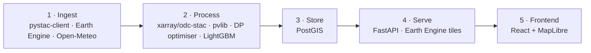
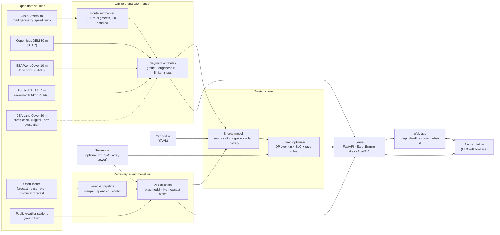

# Architecture, stack and data flow

## General

The architecture style is the **a modular monolith with a batch pipeline**.

| Box | What it does here | Tool |
|---|---|---|
| **Ingest** | Sample the DEM, 10 m land cover and Sentinel-2 L2A along the route corridor; fetch forecasts along the route | pystac-client (Earth Search / CDSE / Planetary Computer) or Google Earth Engine, behind one `RasterSource` interface; Open-Meteo REST |
| **Process** | Segment the route; derive grade, roughness z0 and vegetation; correct forecasts (AI); run the energy model and speed optimiser | xarray + odc-stac, geopandas, pvlib, NumPy DP, LightGBM |
| **Store** | Route, forecasts, plans and results in PostGIS; rasters stay in Earth Engine / STAC; GeoParquet files for local work | PostGIS (Neon) |
| **Serve** | Plans, forecasts and back-tests as JSON; map layers as Earth Engine tile URLs | FastAPI + Earth Engine map tiles |
| **Frontend** | Map, timeline, plan, what-if, re-plan, back-test | React + MapLibre GL |



## Design principles

1. **Hosted for the demo, offline-capable for the race.** The submission needs a
   website that works when someone else opens it, so the main deployment is
   hosted on student cloud credits. Along the outback route there is little
   mobile signal, so the same containers also run on one laptop in the support
   car; internet then only refreshes forecasts.
2. **Files between stages.** Each stage reads and writes GeoParquet/COG with a
   documented schema. A broken stage never breaks the others, and any stage can
   be replaced by a stub.
3. **Traceable.** Every output records the STAC item IDs, the forecast issue time,
   the car-profile hash and the git SHA that produced it.
4. **Generic car.** All car-specific numbers live in one car profile file. No
   team, car or data source is hard-coded.
5. **Plan, then re-plan.** The same optimiser runs before the race (full route)
   and during it (remaining route from the current km, time and battery).

## Data flow



## Plan loop (what happens when you press "Plan")

```mermaid
sequenceDiagram
  participant UI
  participant API
  participant OPT as Optimiser
  participant WX as Forecast store
  UI->>API: POST /plan/run (car profile, start km/time/SoC, scenario)
  API->>OPT: start job
  loop until ETAs stable (max 4×)
    OPT->>WX: conditions at (segment, arrival time)
    WX-->>OPT: irradiance P10/P50/P90, wind, temperature
    OPT->>OPT: DP over km × SoC with race rules
  end
  OPT-->>API: plan (speed per segment, ETAs, SoC band)
  API-->>UI: plan + "safe under P10?" flag
```

## Repository layout 

```
Solar-Race-Planner/
  src/solar_race_planner/
    serve/app.py    FastAPI app with GET /health
  frontend/         React + Vite + TypeScript, Vitest tests
  tests/            API tests
  configs/          car.reference.yaml, race.bwsc.yaml
  data/             local cache
  docs/             this folder
  .github/          CI and deploy workflows, PR template
  requirements.txt  pinned runtime (used by Docker and CI)
  pyproject.toml    package, optional extras (geo, gee, model, dev), pytest and ruff config
  Dockerfile, docker-compose.yml
  README.md         gets it running
  .env.example      settings; copy to .env (git-ignored)
```
